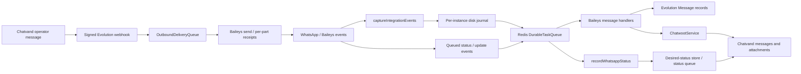

# Production investigation: missing WhatsApp messages and split Bale identity

Date: 3 November 2026. All message times below are **Asia/Tehran (UTC+03:30)**.

This report covers WhatsApp conversations **3330, 2723 and 2338**, plus the
subsequently reported Bale conversations **3775 and 3782**. The three WhatsApp
cases were investigated without sending/retrying messages, modifying application
code, changing configuration, or altering production records. The Bale issue is
diagnosed here; its requested repair is not represented as already implemented.
Diagnostic files were written under temporary directories. No deployment,
commit, push or tag was made during this investigation.

## Findings at a glance

| Case | Confirmed cause | Important distinction |
|---|---|---|
| WhatsApp 3330, `support_wa` | Captured customer reply is never scheduled; its inbound partition head is starved. Status updates are also blocked. | Older customer messages carry a 7-day WhatsApp expiry and remain in the CRM archive. This explains a second, different kind of mismatch. |
| WhatsApp 2723, `radmehr_wa` | A retained album-container event blocks the chat; the scheduler also skips eligible queue heads. | The reported receipt image is captured and its 47,037 bytes are preserved locally. Its absence is not an image download/size problem. |
| WhatsApp 2338, `radmehr_wa` | An ordinary queued message at the chat head has zero attempts; later customer texts are captured but never attempted. | The screenshot's receipt photo cannot be positively matched to a retained original upsert. The text-delivery cause is proven; the photo's original capture failure remains unconfirmed. |
| Bale 3775 / 3782, inbox 48 | One native Bale peer has two Chatvand contact IDs; alias verification permits delivery but does not consolidate the contacts. Conversation reuse is then applied separately to each contact. | Both Wootify reopen and Chatvand single-conversation settings are already enabled. This is a Wootify/Chatvand identity-policy gap, not Evolution. |

The October 31 ordering change I deployed exposed a scheduler starvation
regression. The earlier small-queue tests did not cover the combination of a
40-record scan, four worker slots, and blocked later jobs. Those passing checks
were insufficient to establish production progress.

## What is actually running

At inspection:

- Evolution: `local/evolution-api:2.3.7-softnu.9-tester-20261031`.
- Chatvand Rails and Sidekiq: `local/chatvand:chatvand.3-tester-20261031`.
- Both images have remained running since the October 31 deployment.
- The five inspected Evolution source files match their local counterparts after
  normalizing CRLF/LF line endings: Baileys service, Chatwoot service, durable task
  queue, outbound delivery queue, and Chatwoot controller. This investigation is
  grounded in that deployed code, not an assumed upstream version.

The local working trees already contained uncommitted changes from earlier work.
They were not committed or reset for this investigation.

## The relevant Evolution architecture

WhatsApp uses Baileys socket events. It does not use Wootify's Bale/Eitaa polling
interval. Wootify is not the delivery worker for these WhatsApp inboxes.

Relevant implementation points in the Evolution project:

- `src/api/integrations/channel/whatsapp/whatsapp.baileys.service.ts:273`:
  instance-specific integration journal and delivery callback.
- `whatsapp.baileys.service.ts:326`: capture before asynchronous Chatvand work.
- `whatsapp.baileys.service.ts:444`: media preservation on the instance volume.
- `whatsapp.baileys.service.ts:1880`: reliable status/update handling.
- `src/api/integrations/chatbot/chatwoot/services/durable-task-queue.ts:136`:
  journal registration and bounded scheduling.
- `src/api/integrations/chatbot/chatwoot/services/chatwoot.service.ts:2156`:
  translation of native events into Chatvand operations.
- `src/api/integrations/chatbot/chatwoot/controllers/chatwoot.controller.ts:28`:
  status projection and outbound queues.
- `src/api/integrations/chatbot/chatwoot/services/outbound-delivery.ts:205`:
  submitted/delivered/read/failed status projection.

An original can therefore be absent from Evolution's `Message` table while still
being safely captured in its disk journal and Redis work queue: the database
message handler has not run yet. That is the situation for several reported
messages. A live socket connection does not prove that this worker is advancing.

## Shared defect: queue starvation

`DurableTaskQueue.pollOnce()` reads up to 40 due IDs and immediately advances
`scanOffset` by 40. It then starts at most four jobs. `process()` checks the
per-chat ordering index and returns immediately for a job that is not its chat's
head, without removing or moving that job in the ready set.

Once a page begins with four such blocked jobs:

1. Those four consume the available worker slots for that scan.
2. The remaining 36 IDs in that page are never inspected.
3. The next scan starts at the next 40-record page.
4. When the cursor wraps, the ready ordering is unchanged and the same four IDs
   are selected again.

An eligible conversation head can thus stay pending forever, even though it is
due and has no network failure. Per-chat locking and durable storage do not fix
this scheduling error.

**Reproduction:** executed the actual local scheduler class, whose normalized
source matches production, against synthetic storage with 80 stable ready jobs
and no-op blocked-job outcomes. After 60 polls, only IDs 0–3 and 40–43 were ever
selected; **72 of 80 jobs were never scheduled**. This was a local, isolated
reproduction; no production queue jobs were run by the test.

Production observations agree with this mechanism:

| Head | Ready-set rank, zero based | Rank modulo 40 | Attempts |
|---|---:|---:|---:|
| 2723 album-container head | 87 | 7 | 2,183 historical attempts |
| 2338 normal-message head | 181 | 21 | 0 |
| 3330 inbound control head | 350 | 30 | 0 |
| 2723 old status-update head | 36 | 36 | 3,674 historical attempts |
| 3330 old status-update head | 55 | 15 | 1,279 historical attempts |

Ranks are a snapshot and can change with live activity. Each shown head is outside
the first four slots of its scanned page. Historical failed heads stopped gaining
attempts after October 31, while newer heads remain at zero attempts.

At the captured snapshot there were **1,064 pending journal/Redis events for
radmehr-wa** and **1,281 for support-wa**. These are event counts, including status
updates and protocol events, not 2,345 distinct customer messages. The identical
disk-journal counts support retained backlog rather than wholesale loss of these
captured events.

The outbound queue is a separate class. It already checks conversation heads
before occupying a worker slot. It must not be treated as identical to this
ingress scheduler or broadly rewritten on that assumption.

## Case 1: conversation 3330

[Reported conversation](https://tm.novinmed.com/app/accounts/3/inbox/56/conversations/3330)

### New customer reply missing from Total

The customer reply visible at **November 2, 12:32:39** is present in both the
integration journal and Redis. It was captured approximately **0.702 seconds**
after its original timestamp, but its delivery attempt count is **zero**. The
message has not reached the normal database/Chatvand creation path.

Its per-chat inbound head is an `EPHEMERAL_SYNC_RESPONSE` protocol event at
**12:13:13**, also with zero attempts. It is not evidence of a failed photo upload
or an unavailable customer phone mapping. That head is currently starved by the
scheduler. Protocol controls should also be classified explicitly rather than
treated as customer content.

### Sent/read discrepancies

The operator's **12:11 follow-up**, Chatvand message **109321**, is visible in the
WhatsApp screenshot and has a native send identity. Evolution captured matching
status updates **2, 3 and 4** (server acknowledgement, delivery and read), but
those updates also have **zero attempts**. The outbound job is complete while
the status pipeline has not applied those receipts; the database still says
`PENDING` and Chatvand says `sent`.

This particular follow-up was not proven undelivered. Re-sending it would risk a
duplicate. The correct action is to reconcile its captured receipts.

The update stream has an older head referring to a message for which no original
Evolution or Chatvand message mapping was found. The reliable update handler
retains that event until its mapping exists. Strict ordering then holds later,
independent receipts behind it. Fair scheduling alone will not repair this
unresolvable-head problem.

### Messages retained in Total but missing from the phone view

Eight stored customer messages carry **`expiration: 604800`**, i.e. **seven days**.
This is present both in persisted native context and retained original journal
payloads. The October 24 customer messages would expire in WhatsApp by October 31.
The integration retains their archived Chatvand records and does not implement
matching TTL expiration of CRM history.

The integration's inspected outgoing messages contain ephemeral-setting metadata
but no corresponding expiration duration. They are therefore not equivalent to
those expiring incoming messages. This is a retention/ephemeral-message behavior
gap, not proof that every message seen only in Total failed to send.

Two other apparent differences must be excluded from delivery-failure counts:

- Chatvand **108760** is a **private note**, which should not be sent to WhatsApp.
- Chatvand **108696** already has `deleted: true`. Its creation time corresponds
  to the screenshot's deleted message at November 1, 14:51.

Whether WhatsApp expiry should also remove archived CRM messages is a product
retention decision. This investigation did not delete any CRM history.

## Case 2: conversation 2723

[Reported conversation](https://tm.novinmed.com/app/accounts/3/conversations/2723)

The receipt image at **November 1, 22:03:16** is captured in the journal, registered
in Redis, and has **zero attempts**. Its **47,037 bytes are already preserved on
the Evolution volume**. The earlier 22:01 image and a later November 2 image are
also preserved. The missing receipt is not explained by attachment size, a PDF
limit, or Chatvand failing to render an uploaded file; no Chatvand message has
been created for it yet.

There are two independent barriers:

1. The scheduler starvation described above.
2. The chat's oldest unfinished message is an **October 24 `albumMessage`
   container**, one of two containers each declaring five images. It accumulated
   **2,183 attempts** before the new scheduling condition stopped progress.

The ten actual child images from those two albums already have native database
and Chatvand mappings from October 24. The parent album notification is not an
eleventh image or an ordinary text message. `getTypeMessage()` does not translate
`albumMessage`, and reliable `eventWhatsapp()` throws “WhatsApp message content
needs operator review” for unrecognized empty/non-media content. Making that
container the compulsory FIFO head blocks later real messages.

Recovery must classify and settle album containers with verified child coverage,
retain the actual child files, and avoid duplicating the ten existing images.
Simply increasing retry frequency will not make the container into sendable
content. The revoked earlier receipt must also be accounted for before replaying
the later receipt sequence.

## Case 3: conversation 2338

[Reported conversation](https://tm.novinmed.com/app/accounts/3/conversations/2338)

The customer texts shown at **November 2, 08:44:36** and **08:49:48** are captured
in the journal and queued with **zero attempts**. Capture delays were approximately
**1.192 seconds** and **0.814 seconds**, respectively. These are not missing because
the user has no Chatvand conversation or because the screenshot is being viewed
in a different inbox.

Their head is an ordinary operator-originated message captured on **October 31,
13:13:29**, also at **zero attempts**. Unlike 2723, this chat does not require an
album error to explain its lack of progress: it is a direct scheduler-starvation
example.

The two verified customer texts have not reached Evolution's normal `Message`
database handler or Chatvand creation. Native-app operator messages after them
are also captured in the same unfinished stream.

**Receipt-image limitation:** no original image upsert could be positively matched
to the bank-receipt photo shown in this screenshot. There is a status-only event
for an incoming native message with no matching original in the retained journal,
Evolution database or Chatvand source-ID records. That is insufficient to prove
that this particular missing original is the photo, or to attribute its capture
failure to VPN, decryption or a disconnect.

This inbox has `importMessages=false`. The durable queue protects events that
were captured; it cannot backfill an original never captured on the live path.
The missing photo needs a narrowly scoped history/resend investigation after
preserving the current evidence. It must not be claimed recovered merely because
the two text messages can be unblocked.

## Additional case: Bale conversations 3775 and 3782

[3775](https://tm.novinmed.com/app/accounts/3/conversations/3775) ·
[3782](https://tm.novinmed.com/app/accounts/3/conversations/3782)

The exact same native Bale peer is represented by:

| Item | Conversation 3775 | Conversation 3782 |
|---|---|---|
| Chatvand contact | 6076, no phone | 5856, with phone |
| Inbox | 48 | 48 |
| Current Chatvand status | Open | Open |
| Creation | Nov 2, 15:37:29, first native incoming message | Nov 3, 08:41:03, first operator message |

Contact 5856 already existed in an Eitaa inbox before the Bale conversation.
The native Bale peer was independently verified for that phone when the operator
sent through contact 5856. Wootify saved a **`bale_phone` verified alias** at
**November 3, 08:41:04**. Its canonical contact mapping still points to 6076.
This is evidence of one verified native peer with two UI contacts, not an
instruction to infer identity from matching names.

Both relevant settings are already enabled:

- Wootify `support-bale-pv`: `reopen_conversation=true`.
- Chatvand inbox 48: `lock_to_single_conversation=true`.

The policy breaks at the identity boundary:

1. The original native message had no usable phone, so contact 6076 was created.
2. An operator later started a Bale conversation using the existing phone contact
   5856. Chatvand's create path selects a `contact_inbox` for that contact and
   applies its own single-conversation lookup only inside that association.
3. Wootify's verified alias permits safe delivery to the same Bale peer, but does
   not merge the contacts or make their conversation lists one identity.
4. `_get_or_create_conversation()` filters by canonical contact ID and asks
   `list_contact_conversations()` for that one contact. It cannot see the alias
   contact's conversations when applying the reopen toggle.
5. Outbound mapping upserts always mark the originating conversation active and
   deactivate its sibling peer mappings. Replying in one older UI conversation
   can thus switch the active row, while canonical inbound resolution points
   elsewhere.

Stored mappings show the two UI conversations sending to the same peer. On
November 3, an outbound send in 3775 at **13:22:45** deactivated the 3782 mapping;
the later native reply at **13:37:33** landed in 3775. Toggling reopen again would
not fix these separate contact identities.

### Scope of the requested Bale fix

The repair needs identity-aware conversation creation and selection, not another
identifier overwrite or a change of polling interval:

1. Resolve one instance/account/inbox/native-peer identity before creating an
   agent-side conversation, using canonical mappings and independently verified
   aliases. Chatvand creation needs this information before creating the second
   conversation; the later message webhook is too late to prevent it.
2. Apply the live per-inbox reopen policy to that identity: reuse an unresolved
   conversation; reopen the appropriate resolved one when enabled; otherwise
   create a new conversation after resolution, for the same canonical customer.
3. Preserve historical outbound mappings without blindly promoting every old
   conversation on webhook replay or an operator reply.
4. Reconcile the two existing contacts and, if histories are combined, update
   exact message/conversation mappings and queued status references together.
   Contact merging alone does not merge the conversation histories. Preserve
   message IDs, attachments, reply links and foreign WhatsApp identifiers.
5. Verify both toggle states, native-first and operator-first creation, discovery
   of a phone after initial contact creation, concurrent creates, and replies to
   older conversations before production rollout.

No contact merge, history move, or other Bale repair was performed during this
reporting pass. Those changes must not be described as complete.

## Recommended repair sequence

1. **Fix scheduler progress and add large-queue regression coverage.** Advance the
   cursor only past inspected IDs, or schedule eligible partition heads fairly
   before occupying worker slots. Test more than 40 jobs, blocked later jobs,
   backed-off heads, several partitions, restart and new arrivals. Preserve FIFO
   for real user messages and the existing durable journal.
2. **Classify controls and unresolvable updates.** Settle album containers only
   with child coverage; handle protocol controls explicitly; separate independent
   per-message receipts from a permanently missing older mapping. Keep a durable
   diagnostic/dead-letter record instead of silently discarding uncertain data.
3. **Recover captured inbound work with deduplication and revocation awareness.**
   The 2723 receipt bytes are available. Resume exact captured events, reconcile
   existing source IDs and receipts, and preserve original source timestamps.
   Do not bulk-resend operator messages that have already reached WhatsApp.
4. **Investigate the unmatched 2338 photo independently.** Use a targeted history
   request or a controlled new sample with capture/decryption telemetry. Do not
   enable an unbounded full history import as a substitute for diagnosis.
5. **Decide the disappearing-message archive contract.** Make retention/mirroring
   behavior explicit. Do not delete historic CRM messages as an incidental repair.
6. **Implement the Bale identity/conversation repair described above.** This is a
   separate Wootify/Chatvand change and should have independent validation.

## Observability and limits

The inspected log tail contained 4,012 “Integration media preservation unresolved”
messages between roughly 17:55 and 18:00 on November 3. The October 31 sampled tail
is similarly dominated by these warnings. Failure details often collapse to
`Error`; job records do not retain enough safe context to reconstruct all older
exceptions. These counts describe bounded log samples, not all incidents in the
date range, and do not establish a DNS/VPN root cause.

Record job/partition fingerprints, event kind, stable error category, retry age,
oldest pending age and “due head with zero attempts” metrics. Back off/rotate
failed media-preservation attempts and avoid repeated uncorrelated warning floods.
An “open” WhatsApp connection must not be used as the only integration-health
indicator.

The proven common fault here is in Evolution's worker scheduling. In 2723,
unsupported album metadata adds a second proven blocker. In 3330, native expiry
explains older archive differences. The 2338 photo's original capture remains an
explicit evidence gap. The Bale split is an identity-policy gap in the other two
projects. These causes should not be conflated into one networking diagnosis.

## Evidence and reproducibility

Sanitized local metadata and the isolated scheduler reproduction are in:

`C:/Users/amin/Desktop/wootify_instance_manager/tmp/wa-investigation-20261103/`

Key files: `queues_queue.json`, `queues_journal.json`, `queues_outbound.json`,
`native_messages.json`, `chatvand_messages.json`, `expiration_metadata.json`,
`missing_media_trace.json`, `bale_canonical.json`, `bale_aliases.json`,
`bale_conversation_policy.json`, `deployed_source_hashes.json`, and
`scheduler-reproduction.json`. Public summaries exclude message bodies, phone
numbers, bank details, media keys and credentials. Raw matching identities were
used only inside restricted temporary files on production.
